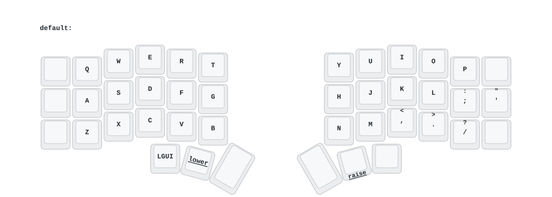
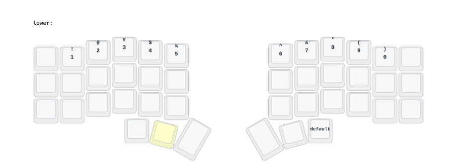
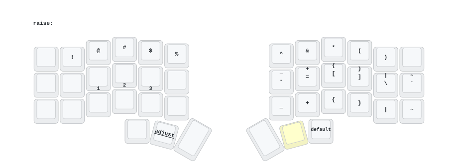
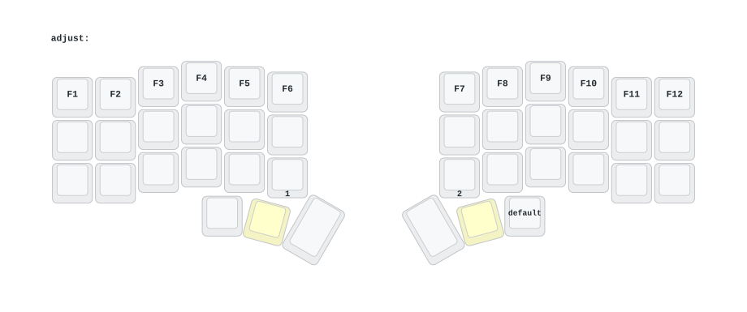

# zmk-config-corne

[English](./README.en.md) · **简体中文**

Corne 分体键盘的 ZMK 固件配置，已接入 [DYA Studio](https://studio.dya.cormoran.works/)。

## 关于 Corne

[Corne](https://github.com/foostan/crkbd)（又名 **crkbd**，取自 cornetto 意式甜点的名字）
是日本开发者 foostan（Kosuke Adachi）设计的开源分体人体工学键盘，
最初发布于 2018 年 4 月，灵感来自 Helix 键盘。

它的核心特征：

- **3×6 列错位 + 3 枚拇指键**（单侧），共 42 键。列错位（column stagger）能让手指
  沿各自自然的列方向上下移动，比行错位更省手腕动作 —— 这一布局后来启发了大量同类设计
- **对称双 PCB + TRRS 互联** —— 左右完全相同，单价低、易焊接
- **开放式** —— 从第一天就开源，任何人都能自己打样、改键位、做外壳衍生
- **可拆最外侧列** —— 多数版本的最外列可拔掉，变成 3×5+3 的 34 键布局

正因为设计开放、门槛低，Corne 成为近十年最流行的分体键盘设计之一，
衍生出 Classic / Cherry / Chocolate / Light 等官方分支，以及大量社区版本。

本仓库针对的是 **V4 外形 + Pro Micro 尺寸插座**这一支，见下一节。

## 适配的硬件

**[Corne V4 Pro-Micro Edition](https://github.com/klouderone/CorneV4ProMicroEdition)**
（Kea Workshop 出品，klouderone 维护的分支）—— foostan 原版 Corne V4 外形，
保留 Pro Micro 尺寸插座，可插 [nice!nano v2](https://nicekeyboards.com/nice-nano) 做无线，
也可插 Elite-C v4 做有线。

| 项目 | 说明 |
| --- | --- |
| 微控制器 | nice!nano v2（本配置的目标）/ 其他 Pro Micro 尺寸板 |
| 轴座 | Kailh **MX** 与 **Choc** 热插拔底都支持，带拔插可做 5 列 |
| 二极管 | SMD 1N4148 与插件二极管都支持 |
| 显示 | 0.91" OLED（I²C）或 nice!view 扩展板 |
| 连接 | 3.5mm TRRS 分体互联 + 电池焊盘 / PH2 座 / 电源开关 |
| 底灯 | ❌ 无 RGB 底灯，所以配置里的 underglow 是关闭的 |
| 键距 | 19.05mm（V4 相比 V3 由 19mm 微调） |

> **别买错版本。** foostan 官方的 Corne V4 是**板载 RP2040**、USB-C 接口，
> 既插不了 nice!nano 也用不了本仓库的无线固件。只有 Kea Workshop 的
> Pro-Micro 版才兼容 Pro Micro 尺寸的板子。

> 本配置按 **MX 轴体** 编译矩阵接线。PCB 的 Choc 轴座虽然硬件兼容，
> 但 Choc 的行列引脚分配与 MX 不同，ZMK 自带的 `corne` shield 只定义了 MX 版本。
> 若实际焊接的是 Choc 轴体，需要另行配置 Choc 矩阵，本仓库暂未包含。

> ⚠️ 该板是无线 + 有线两用设计：**插电池时不要用 TRRS**，**用有线时不要接电池**。
> 本仓库的固件为无线版本（nice!nano）。

## Keymap 布局

以下图形由 `keymap-drawer/corne.svg` 按层拆分而来，随 `config/corne.keymap`
变更通过 GitHub Actions（`keymap_drawer.yml`）自动重新生成。

**默认层（default）**



**LOWER（数字 / 方向 / 音量）**



**RAISE（符号 / 蓝牙 / Studio 解锁）**



**ADJUST（F 键 / 亮度 / 媒体 / Bootloader）**



完整图（含全部 4 层）：[`keymap-drawer/corne.svg`](keymap-drawer/corne.svg)

### 图层与进入方式

| 索引 | 标签 | 内容 | 进入方式 |
| --- | --- | --- | --- |
| 0 | `default` | 主键区（QWERTY） | — |
| 1 | `lower` | 数字、方向键、音量控制 | 按住左手第 2 枚拇指键（`&mo 1`） |
| 2 | `raise` | 符号、蓝牙配置档、USB/BLE 切换、`&studio_unlock` | 右手第 2 枚拇指键短按退格 / 长按进层（`&lt 2 BACKSPACE`） |
| 3 | `adjust` | F1–F12、亮度、媒体控制、`&bootloader`、`&out OUT_TOG`、`&bt BT_CLR` | `lower` + `raise` 同按，或在 `raise` 层按住左手第 2 枚拇指键（`&mo 3`） |

> `lower` / `raise` / `adjust` 三层最右侧拇指键均为 `&mo 0` 兜底，按住可临时回到 `default` 层。

## DYA Studio

浏览器打开 <https://studio.dya.cormoran.works/>，按 splash 页面选择连接方式：

| 方式 | 说明 | 支持的浏览器 |
| --- | --- | --- |
| USB | 插线后选择串口（Web Serial） | Chrome / Edge（桌面） |
| Bluetooth | 配对后通过 BLE 连接（Web Bluetooth） | Chrome / Edge（桌面）、Android Chrome、iOS 用 Bluefy |
| Demo | 无需键盘，模拟键盘试用全部界面 | 同上 |

Firefox 与 Safari 不支持。

### 可用功能

- **Keymap Editor** — 可视化编辑键位与图层，按键实时高亮
- **Macros & Combos** — 网页上直接创建宏与组合键，**无需重新编译固件**
- **Connection Management** — BLE 配置档重命名 / 切换 / 解绑，设置 USB 与蓝牙的优先级
- **Device Settings** — 电源管理（idle / deep sleep 超时）、各分半独立设置
- **Troubleshooting** — 电量、固件版本、uptime；逐键抖键检测；复制完整支持报告

> **按 OS 自动切层**需要 central 半边开启 OS Detection 与 Default Layer 模块。
> Corne 无轨迹球，因此 DYA Studio 的 Trackball Tuning 与相关模块（PMW3610 驱动）不适用。

### 左右半分配

**本键盘的 central（主控）是左手** —— USB 与 BLE 都接左手，DYA Studio 网页也只会连上左手。

| | 左手 · central | 右手 · peripheral |
| --- | --- | --- |
| **刷哪个固件** | **`corne_left*`** | **`corne_right*`** |
| USB / BLE 连接 | 是 | — |
| Studio 通信 | 是 | — |
| 连接管理、OS 识别、按 OS 切层 | 是 | — |
| 设置中继 | 发起 | 接收并应用 |
| 抖键诊断、看门狗 | 汇总两半 | 检测本半并上报 |

这与 ZMK 自带的 corne shield 一致（`cormoran/zmk` 的 `main+dya` 分支同样如此）：
`boards/shields/corne/Kconfig.defconfig` 里就是 `if SHIELD_CORNE_LEFT →
ZMK_SPLIT_ROLE_CENTRAL default y`。**ZMK 的 corne 默认就是左手主控，不是右手。**

> ⚠️ **刷反了整把键盘会完全没有输入**（central 与 peripheral 配不上）。
> 记住：**插 USB 的那一半 = 左手 = 刷 `corne_left*`**。
>
> 如果你的接线确实是 USB 插右手，需要三处一起改：
> 1. `Kconfig.defconfig` 里把 `SHIELD_CORNE_LEFT` 改成 `SHIELD_CORNE_RIGHT`；
> 2. 把两个 snippet 目录改名互换（`corne-central` ↔ `corne-peripheral`），
>    并同步 `build.yaml` 里各变体 `snippets:` 列表中的名字；
> 3. 把 `build.yaml` 里各变体的 `shield:` 与 `artifact:` 一起对调。

### Studio 锁定

本仓库固件**默认处于 unlock（常开）状态**：`snippets/corne-central/corne-central.conf`
里设了 `CONFIG_ZMK_STUDIO_LOCKING=n`，断开连接或空闲后不会重新锁定，
Web Bluetooth / WebUSB 可以直接连上键盘改键位。

如果删掉该配置恢复默认的"断开即锁定"行为，锁定状态下浏览器的 Web Bluetooth
会扫不到这块键盘，可用 keymap 保留的解锁键作为兜底入口：

```
进 RAISE 层：LAYER_0 的第 7 枚键（右手第 2 枚拇指键）—— 短按退格 / 长按进 RAISE
解锁 Studio：RAISE 层上的左手第 1 枚拇指键（GUI 位）
备用解锁位：ADJUST 层上的左手第 3 枚拇指键（Space 位）
```

> 各层的进出方式（`&mo 0` 兜底键）：
> LAYER_0 → LOWER 用左手第 2 枚拇指键；LAYER_0 → RAISE 用右手第 2 枚拇指键；
> RAISE → ADJUST 用左手第 2 枚拇指键；LOWER + RAISE 同按直接到 ADJUST。
> LOWER / RAISE / ADJUST 三层的最右 1 枚拇指键都是 `&mo 0`，按住可临时回到
> LAYER_0 —— 这样即使在 DYA Studio 里把某一层设成了基础层，也不会被锁死出不来。
> USB / BLE 输出切换在 ADJUST 层（`&out OUT_TOG`），不要按 `&out OUT_USB`：
> 后者切过去以后没插线就完全没有输出。

## 固件变体

Actions → 最新一次构建 → Artifacts → `zmk-firmware`，内含以下 `.uf2`：

| Artifact | 说明 |
| --- | --- |
| `corne_left_oled` / `corne_right_oled` | SSD1306 OLED 显示 |
| `corne_left_niceview` / `corne_right_niceview` | nice!view 适配板 |
| `settings_reset` | 清除所有持久化设置（含 DYA Studio 保存的配置） |

左右半分别刷对应文件。`settings_reset` 刷完后再刷正常固件即可。

### 显示接线

两个显示变体都对应板上的排针座，选一个刷就行：

- **OLED 变体** — 插 4 针 PH5 座，I²C，地址 `0x3C`，128×32
- **nice!view 变体** — 插 5 针 PH5 座，SPI（SCK P0.20 / MOSI P0.17 / MISO P0.25 / CS P1.1）
  自带 `CONFIG_SSD1306=n`，不会和 OLED 驱动打架

## ZMK KeyTester（物理矩阵测试）

本仓库已集成 [tangbonze/zmk-matrix-tester](https://github.com/tangbonze/zmk-matrix-tester)
固件模块，配合 [ZMK KeyTester](https://github.com/tangbonze/zmk-keyboard-tester)
网页端可进行硬件级物理矩阵直读测试（无需开启 `CONFIG_ZMK_USB_LOGGING=y`）。

1. 将左手（central）通过 USB 数据线连接到电脑（需桌面版 Chrome / Edge）。
2. 打开预载本仓库配置的在线测试页：
   <https://tangbonze.github.io/zmk-keyboard-tester/?config=https://github.com/tangbonze/zmk-config-corne>
3. 点击顶部 **「WebHID 物理矩阵」**，选择你的键盘即可直接点亮左右手任意物理轴体，并支持静默拦截模式防误触。

> 该模块仅在左手（central）启用独立 Raw HID 接口（`HID_1`，`0xFF60 / 0x61`），
> 不干扰标准键盘输出与蓝牙；拔掉 USB 使用电池时零代码执行、不影响深度休眠。

## 本地构建

需要 [Zephyr SDK](https://docs.zephyrproject.org/latest/develop/toolchains/index.html) 和
[`west`](https://docs.zephyrproject.org/latest/develop/west/install.html)。

需要 **Python 3.12**（Zephyr 4.1 不支持 3.13/3.14）和 Zephyr SDK 0.17.0：

```bash
brew install python@3.12
python3.12 -m venv .venv && ./.venv/bin/pip install west
# SDK 0.17.0 的 macOS 包不含 hosttools，但 Zephyr 4.1 有回退逻辑，实测可用
export ZEPHYR_SDK_INSTALL_DIR=~/zephyr-sdk-0.17.0

# 依赖下载到 ./dependencies
west init -l config
# 或下载到仓库上一级（多个 config 仓库共享同一份 ZMK）
# west init -l . --mf config/west-workspace.yml

west update --narrow
west zephyr-export
# Studio 的 nanopb 生成器需要这两个包，否则构建会在生成 proto 时失败
./.venv/bin/pip install "protobuf>=5.27" grpcio-tools

west zmk-build                        # 构建 build.yaml 里的全部变体
west zmk-build -a corne_right_oled    # 只构建某一个
west zmk-build -a corne_left_oled -p always   # 改过配置后必须 pristine 重建

# 烧录必须指定单个变体（多目标时 --flash 会直接报错退出）
west zmk-build -a corne_left_oled --flash

# 排查问题时编一个带 USB 日志的固件（会多占 flash，日常固件不受影响）
west zmk-build -a corne_left_oled -S zmk-usb-logging --flash
```

固件输出在 `./build/<artifact>/zephyr/zmk.uf2`。

## 排查

固件能编译通过不代表功能都打开了。最典型的例子：DYA Studio 的全部 Kconfig 如果
没被正确加载，固件照样能编过、刷进去也能打字，但 Studio 协议栈压根没被链接进去 ——
表现就是"连不上 Studio"。

**1. 先看构建日志里的 Kconfig warning —— 本仓库当前是 0 条。** 每条
`assigned the value 'y' but got 'n'` 都意味着某个功能没开，warning 里带符号名：

```bash
grep -iE "warning: (assigned|attempt to assign|choice symbol)" \
  build/corne_left_oled/stdout_and_stderr.log
```

**2. 确认构建实际合并了哪些 `.conf`。** 这是定位"配置没生效"最快的办法 ——
如果列表里出现的是 `dependencies/zmk/app/boards/shields/corne/corne_left.conf`
（ZMK fork 里的空文件）而不是本仓库的 snippet，就说明配置根本没被读到：

```bash
grep -oE "[^ ']*\.conf" build/corne_left_oled/stdout_and_stderr.log | sort -u
```

正确的输出里应该能看到 `snippets/corne-central/corne-central.conf`。

**2. 核对最终生效的 `.config`。** 下面这些必须全是 `y`，任何一行是 `n`
说明对应功能没打开（最典型的是 `ZMK_BEHAVIOR_LOCAL_ID_TYPE_CRC16`，
它必须和 DYA Studio 网页端一致，否则 Macros / Combos / Keymap Editor 写入的
绑定对不上现有按键，表现为「改了没反应」）：

```bash
grep -E "ZMK_STUDIO|PHYSICAL_LAYOUTS|FAST_KEYMAP|KSCAN_DIAG|WATCHDOG|OS_DETECTION|DEFAULT_LAYER|BLE_MANAGEMENT|RUNTIME_(MACRO|COMBO|INPUT)|INPUT_STREAM|DEVICE_INFO|LOCAL_ID_TYPE|ZMK_MATRIX_TESTER" \
  build/corne_left_oled/zephyr/.config | grep -v "=n$"
```

**3. 抓设备日志。** 日常固件关了 `CONFIG_CONSOLE` 以省 flash，排查时用
`-S zmk-usb-logging` 编一个带日志的版本。

**4. 键盘完全没有输入**，先确认没刷反：插 USB 的那半必须是 `corne_left*`。

## 目录结构

```
config/
  corne.keymap            键位定义（分层布局，含注释图示）
  corne.json              外部 keymap-editor / keymap-drawer 用的布局描述
                          （注意：它不参与编译，也不决定 DYA Studio 的键盘图形，
                            Studio 的图形来自 ZMK fork 内置的 physical-layout）
  corne.conf              两半共用的 Kconfig（蓝牙、电池、sleep、栈大小……）
  west-dependency.yml     依赖清单：ZMK fork + DYA Studio 模块栈 + zmk-matrix-tester
  west.yml                默认 west 入口
  west-isolated.yml       依赖装到 ./dependencies
  west-workspace.yml      依赖装到 west topdir
boards/shields/corne/
  Kconfig.defconfig       只放键盘名 + 分体角色 + 上游继承项
  Kconfig.shield          shield 标识
snippets/
  corne-central/          左手（central）专用 Kconfig：ZMK Studio 及全部
                          *_STUDIO_RPC、OS 识别、默认层、连接管理、各扩展模块
  corne-peripheral/       右手（peripheral）专用 Kconfig：只接收 / 应用设置中继
  corne-oled/             OLED 显示
  corne-no-display/       禁用板载 OLED，回收 flash
zephyr/module.yml         告诉 west 在哪里找 boards / snippets
build.yaml                构建矩阵
keymap_drawer.config.yaml keymap-drawer 样式与键位图标配置
keymap-drawer/
  corne.yaml              keymap-drawer 解析后的中间描述
  corne.svg               完整键位图（含全部 4 层）
  layers/*.svg            按层拆分的独立 SVG（供 README 嵌入）
tools/
  split_keymap_svg.py     将 corne.svg 拆分为各层独立 SVG
.github/workflows/
  build.yml               ZMK 固件构建工作流
  keymap_drawer.yml       随 config/** 变更自动重绘 keymap 图
```

> `corne.dtsi` / `corne_left.overlay` / `corne_right.overlay` 以及物理布局
> （`foostan_corne_6col_layout`）都来自 `cormoran/zmk` 的 `main+dya` 分支，
> 本仓库不重复定义。

### 按半边拆分配置：为什么用 snippet 而不是 `<shield>.conf`

DYA Studio 的 Kconfig 必须按半边隔离（`*_STUDIO_RPC` 依赖的 protobuf 桩代码
只在 central 生成，右手一旦开启就会因缺少 `proto/zmk/custom.pb.h` 而编译失败）。
本仓库通过 `build.yaml` 里每个变体的 `snippets:` 来做这个隔离：

| 文件 | 作用域 | 放什么 |
| --- | --- | --- |
| `Kconfig.defconfig` | shield | 键盘名、分体角色、上游继承的 `ZMK_SPLIT` / 显示 / LVGL |
| `snippets/corne-central` | 仅左手 | Studio / RPC / OS 识别 / 默认层 / 各扩展模块 |
| `snippets/corne-peripheral` | 仅右手 | 只接收并应用设置中继 |
| `config/corne.conf` | 两半 | 蓝牙、电池、sleep、分体事件中继、线程栈 |

**踩过的坑：把配置放进 `boards/shields/corne/corne_left.conf` 是无效的。**
Zephyr 的 `SHIELD_ROOT` 只解析到**第一个**包含该 shield 的 board root，而 ZMK 的
`app/boards` 排在前面，于是构建日志里出现的是

```
dependencies/zmk/app/boards/shields/corne/corne_left.conf   ← ZMK fork 里的空文件
```

而不是仓库里的那份。`Kconfig.defconfig` 之所以有效，是因为 Zephyr 会对
**全部** board root 做 `osource`。所以想按半边隔离配置，只有两条路：

1. `Kconfig.defconfig` + `default y`（原仓库的做法，能生效，但依赖不满足时会被
   **静默丢弃、不产生任何警告**，很容易出现"编译通过但功能没开"）；
2. **snippet**（本仓库现在的做法，走 `EXTRA_CONF_FILE`，已实测生效）。
   它是显式赋值，依赖不满足时会明确报 warning，同时天然按半边隔离。

排查这个问题最快的办法是看构建日志里实际合并了哪些 `.conf`：

```bash
grep -oE "[^ ']*\.conf" build/corne_left_oled/stdout_and_stderr.log | sort -u
```

## 依赖来源

本仓库不使用 ZMK 官方 `main` / `v0.3`，而是 [cormoran/zmk](https://github.com/cormoran/zmk)
的 `main+dya` 分支 —— 它在 ZMK main 之上加了 DYA Studio 所需的
自定义 Studio RPC 协议与分体中继支持。**DYA Studio 的扩展功能依赖这个 fork**，
换回官方 ZMK 只能保留基础的 keymap 编辑功能。

> ⚠️ cormoran 的 ZMK fork 为实验性分支，针对 DYA 键盘优化，可能包含不稳定的变更。
> 自己用着没问题，但不建议用于需要高稳定性的场合。仓库配置了每周五一次的
> 定时构建，用于监控上游变更带来的破坏。

## License

MIT
